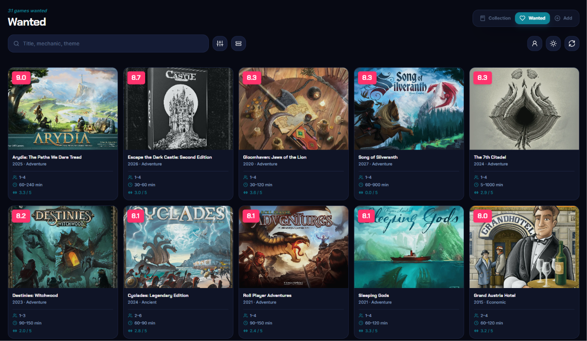

# Board Game Library

A personal board game collection and play tracker for keeping an owned collection, a wanted list, and game-night history in one place.

## Live demo

[Open Board Game Library](https://boardgames-library-ten.vercel.app/)

Visitors can browse and search the public library. Only the owner can make changes.

## Tech stack

- Next.js App Router, React, and TypeScript
- Tailwind CSS 4
- Supabase Auth and Postgres
- BoardGameGeek XML API, parsed with `fast-xml-parser`
- IndexedDB and a service worker for offline reading

## Features

- Browse Collection and Wanted lists in responsive grid or list layouts, with search, filters, and sorting.
- Search BoardGameGeek, select a matching game, and import its metadata.
- Manually refresh BGG-linked games to update metadata and add newly listed expansions.
- View game details, mark expansion ownership, and log, edit, or delete play sessions.
- Sign in to manage games and play history.

## Decisions & trade-offs

- **A public library with owner-managed changes.** The collection is public so it can be shared, while Supabase row-level security limits changes to the owner. The current policies also make play records and notes publicly readable, so they should not contain private information. I chose one shared shelf over separate private libraries for each account.
- **A server-side BGG proxy with manual refresh.** BGG requests go through a Next.js route so the API token stays on the server. Searches and refreshes happen only when requested, rather than through background polling. This avoids unnecessary automatic requests, but metadata can be out of date until the owner refreshes it.
- **Separate game, expansion, and play records.** Expansions and play sessions are stored in their own tables and linked to games. This keeps ownership and play-history changes separate from the game record; the detail page loads related records with additional queries.
- **Custom components instead of a UI library.** React components and Tailwind styles were enough for this project and avoid adding a component-library dependency. The trade-off is that I maintain the styling and responsive behavior directly.

## How I built it

I built this with AI assistance (Claude in VS Code). I directed the product requirements and reviewed and revised the generated changes to match the intended behavior.

## Known limitations

- Play records, including notes, are publicly readable; do not enter private information.
- The app is designed around one owner-managed library, not separate libraries for multiple users.
